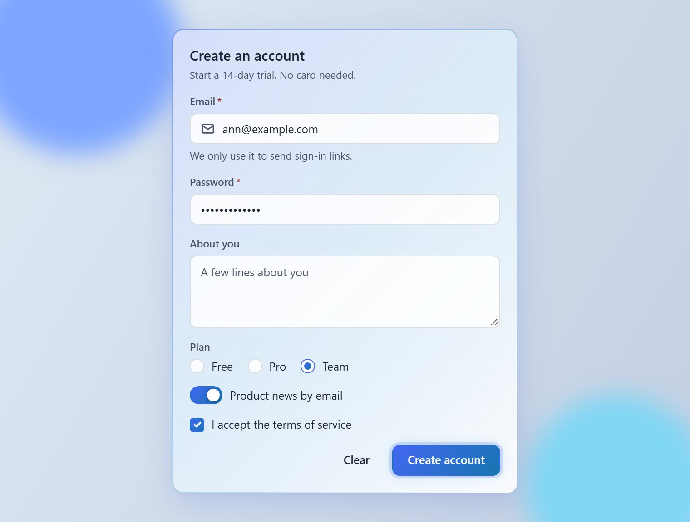

# h2d-glass-ui

[](https://www.npmjs.com/package/h2d-glass-ui)
[](https://github.com/hunghdvn/h2d-glass-ui/actions/workflows/ci.yml)
[](LICENSE)

Glassmorphism UI components for React 18.3+ and 19: 40 accessible components with light and dark
themes, in plain CSS with no runtime styling, ready for React Server Components.

<p align="center">
  <picture>
    <source media="(prefers-color-scheme: dark)" srcset="https://raw.githubusercontent.com/hunghdvn/h2d-glass-ui/main/docs/readme/sign-up-dark.jpg">
    
  </picture>
</p>

<p align="center">
  <a href="https://hunghdvn.github.io/h2d-glass-ui/"><strong>Documentation and live examples</strong></a>
  ·
  <a href="https://hunghdvn.github.io/h2d-glass-ui/?path=/docs/docs-getting-started--docs">Getting started</a>
  ·
  <a href="https://hunghdvn.github.io/h2d-glass-ui/?path=/docs/docs-theming--docs">Theming</a>
  ·
  <a href="CHANGELOG.md">Changelog</a>
</p>

> Status: 0.x. The API may still change between minor versions; the changelog says how.

## Why h2d-glass-ui

- **Glass that holds up.** Frosted surfaces built on `backdrop-filter`. When a browser cannot blur,
  or the system asks for less transparency, surfaces turn solid. They gain contrast under
  `prefers-contrast: more`, follow forced colours, and stop moving under reduced motion.
- **Light, dark and nested themes.** Set `data-flg-theme="light"` or `"dark"` on `<html>` or on any
  element, so a dark sidebar can sit beside a light page. Every colour is a CSS custom property.
- **Plain CSS, no runtime.** One stylesheet, in the `flg` cascade layer: your own CSS overrides it
  without `!important`. No CSS-in-JS and no provider to set up.
- **Works in React Server Components.** Components that need the browser carry their own
  `'use client'`, checked in CI.
- **Native underneath.** Dialogs, drawers, popovers, tooltips, menus and selects use `<dialog>` and
  the Popover API: no portals and no z-index to manage. Form controls are real form elements, so
  `FormData`, the browser's validation, form reset and form libraries work as usual.
- **Accessible.** Keyboard and screen-reader behaviour target WCAG 2.2 AA (see
  [Accessibility](#accessibility)).
- **Small.** Two runtime dependencies (`@floating-ui/dom` and `clsx`). Every export together is about
  47 kB of JavaScript and 13 kB of CSS, minified and compressed with Brotli, and the JavaScript
  tree-shakes to what you import. Size limits are checked in CI.

## Install

```bash
pnpm add h2d-glass-ui
# or: npm install h2d-glass-ui
# or: yarn add h2d-glass-ui
```

`react` and `react-dom` 18.3 or 19 are peer dependencies.

## Quick start

Load the styles once, at the root of the app, then use the components:

```tsx
import 'h2d-glass-ui/styles.css';
import { Button, Card, CardContent, CardFooter, Field, Input } from 'h2d-glass-ui';

export function SignIn() {
  return (
    <Card asChild>
      <form action="/sign-in">
        <CardContent>
          <Field label="Email" required>
            <Input name="email" type="email" autoComplete="email" />
          </Field>
        </CardContent>
        <CardFooter>
          <Button type="submit">Send sign-in link</Button>
        </CardFooter>
      </form>
    </Card>
  );
}
```

Pick the theme with an attribute on `<html>`, or on any element for a part of the page:

```html
<html data-flg-theme="dark"></html>
```

With next-themes, pass `attribute="data-flg-theme"` to its `ThemeProvider`.

## Components

- **Surfaces:** [Surface], [Card], [Divider]
- **Actions:** [Button], [IconButton]
- **Forms:** [Field], [Input], [Textarea], [Checkbox], [RadioGroup], [Switch], [Select], [Combobox], [TagInput], [Slider], [NumberInput], [SegmentedControl], [FileUpload], [Calendar], [DatePicker]
- **Overlays:** [Dialog], [Drawer], [Popover], [Tooltip], [DropdownMenu], [ContextMenu], [Toast]
- **Navigation:** [Tabs], [Accordion], [Breadcrumb], [Pagination], [Stepper]
- **Data display:** [Table], [List], [Badge], [Avatar]
- **Feedback:** [Alert], [Progress], [Skeleton], [Spinner]

The docs also have worked examples: a [sign-up form](https://hunghdvn.github.io/h2d-glass-ui/?path=/docs/examples-sign-up-form--docs),
[loading states](https://hunghdvn.github.io/h2d-glass-ui/?path=/docs/examples-loading-states--docs) and
[showing data](https://hunghdvn.github.io/h2d-glass-ui/?path=/docs/examples-show-data--docs).

## Theming

Override the theme inputs on `:root` and on `[data-flg-theme]`, since each element with that
attribute declares the theme again:

```css
:root,
[data-flg-theme] {
  --flg-accent-start: #7c3aed;
  --flg-accent-end: #db2777;
}
```

The [Theming](https://hunghdvn.github.io/h2d-glass-ui/?path=/docs/docs-theming--docs) page lists
every token, with its values in the light, dark, higher-contrast and solid modes.

## Accessibility

Behaviour targets WCAG 2.2 AA: keyboard use, focus management and screen-reader names, roles and
states. The default colours reproduce the approved design and miss the AA contrast minimums in a few
documented places. The [Accessibility](https://hunghdvn.github.io/h2d-glass-ui/?path=/docs/docs-accessibility--docs)
page lists them and provides a ready-made AA override.

## Browsers and package format

- The last two versions of Chrome, Edge, Firefox and Safari, and Safari and iOS 17.4 or later
  (the overlays need the Popover API and `<dialog>` as Safari 17.4 has them).
- ESM only, with TypeScript types. Node 20.19+ can `require()` it.

## Contributing

Issues and pull requests are welcome. [CONTRIBUTING.md](CONTRIBUTING.md) explains the setup,
the checks and how releases are made. To work on the docs locally:

```bash
pnpm install
pnpm storybook
```

## License

[MIT](LICENSE)

[Surface]: https://hunghdvn.github.io/h2d-glass-ui/?path=/docs/foundation-surface--docs
[Card]: https://hunghdvn.github.io/h2d-glass-ui/?path=/docs/components-card--docs
[Divider]: https://hunghdvn.github.io/h2d-glass-ui/?path=/docs/components-divider--docs
[Button]: https://hunghdvn.github.io/h2d-glass-ui/?path=/docs/components-button--docs
[IconButton]: https://hunghdvn.github.io/h2d-glass-ui/?path=/docs/components-iconbutton--docs
[Field]: https://hunghdvn.github.io/h2d-glass-ui/?path=/docs/components-field--docs
[Input]: https://hunghdvn.github.io/h2d-glass-ui/?path=/docs/components-input--docs
[Textarea]: https://hunghdvn.github.io/h2d-glass-ui/?path=/docs/components-textarea--docs
[Checkbox]: https://hunghdvn.github.io/h2d-glass-ui/?path=/docs/components-checkbox--docs
[RadioGroup]: https://hunghdvn.github.io/h2d-glass-ui/?path=/docs/components-radiogroup--docs
[Switch]: https://hunghdvn.github.io/h2d-glass-ui/?path=/docs/components-switch--docs
[Select]: https://hunghdvn.github.io/h2d-glass-ui/?path=/docs/components-select--docs
[Combobox]: https://hunghdvn.github.io/h2d-glass-ui/?path=/docs/components-combobox--docs
[TagInput]: https://hunghdvn.github.io/h2d-glass-ui/?path=/docs/components-taginput--docs
[Slider]: https://hunghdvn.github.io/h2d-glass-ui/?path=/docs/components-slider--docs
[NumberInput]: https://hunghdvn.github.io/h2d-glass-ui/?path=/docs/components-numberinput--docs
[SegmentedControl]: https://hunghdvn.github.io/h2d-glass-ui/?path=/docs/components-segmentedcontrol--docs
[FileUpload]: https://hunghdvn.github.io/h2d-glass-ui/?path=/docs/components-fileupload--docs
[Calendar]: https://hunghdvn.github.io/h2d-glass-ui/?path=/docs/components-calendar--docs
[DatePicker]: https://hunghdvn.github.io/h2d-glass-ui/?path=/docs/components-datepicker--docs
[Dialog]: https://hunghdvn.github.io/h2d-glass-ui/?path=/docs/components-dialog--docs
[Drawer]: https://hunghdvn.github.io/h2d-glass-ui/?path=/docs/components-drawer--docs
[Popover]: https://hunghdvn.github.io/h2d-glass-ui/?path=/docs/components-popover--docs
[Tooltip]: https://hunghdvn.github.io/h2d-glass-ui/?path=/docs/components-tooltip--docs
[DropdownMenu]: https://hunghdvn.github.io/h2d-glass-ui/?path=/docs/components-dropdownmenu--docs
[ContextMenu]: https://hunghdvn.github.io/h2d-glass-ui/?path=/docs/components-contextmenu--docs
[Toast]: https://hunghdvn.github.io/h2d-glass-ui/?path=/docs/components-toast--docs
[Tabs]: https://hunghdvn.github.io/h2d-glass-ui/?path=/docs/components-tabs--docs
[Accordion]: https://hunghdvn.github.io/h2d-glass-ui/?path=/docs/components-accordion--docs
[Breadcrumb]: https://hunghdvn.github.io/h2d-glass-ui/?path=/docs/components-breadcrumb--docs
[Pagination]: https://hunghdvn.github.io/h2d-glass-ui/?path=/docs/components-pagination--docs
[Stepper]: https://hunghdvn.github.io/h2d-glass-ui/?path=/docs/components-stepper--docs
[Table]: https://hunghdvn.github.io/h2d-glass-ui/?path=/docs/components-table--docs
[List]: https://hunghdvn.github.io/h2d-glass-ui/?path=/docs/components-list--docs
[Badge]: https://hunghdvn.github.io/h2d-glass-ui/?path=/docs/components-badge--docs
[Avatar]: https://hunghdvn.github.io/h2d-glass-ui/?path=/docs/components-avatar--docs
[Alert]: https://hunghdvn.github.io/h2d-glass-ui/?path=/docs/components-alert--docs
[Progress]: https://hunghdvn.github.io/h2d-glass-ui/?path=/docs/components-progress--docs
[Skeleton]: https://hunghdvn.github.io/h2d-glass-ui/?path=/docs/components-skeleton--docs
[Spinner]: https://hunghdvn.github.io/h2d-glass-ui/?path=/docs/components-spinner--docs
